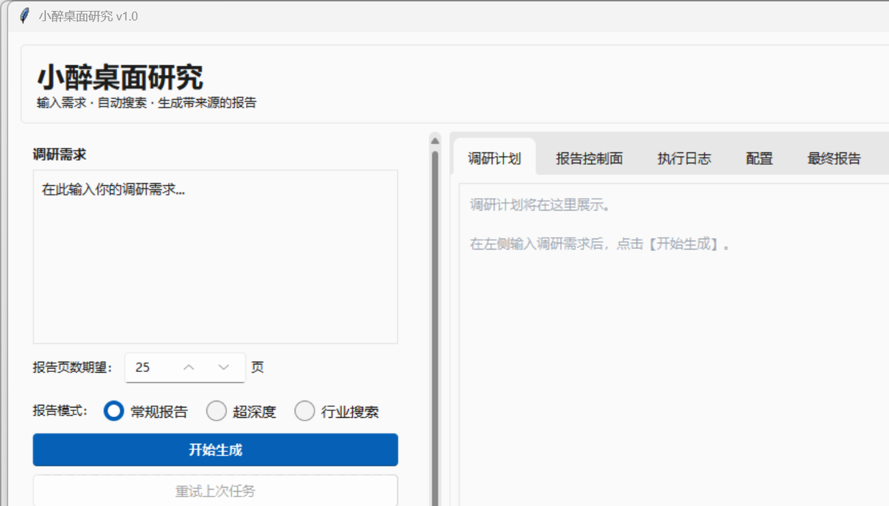
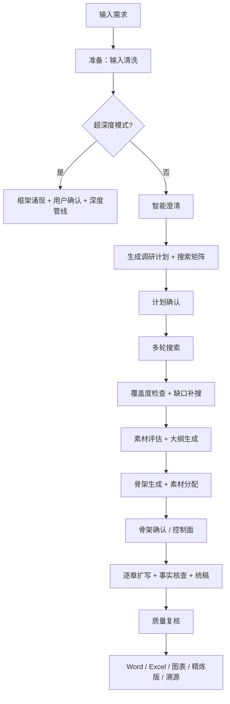

# 小醉桌面研究 v1.0

> 让AI成为代码的粘合剂，一条受控的工程流水线：人负责需求，AI负责提问、规划、写作和复核，代码负责边界、预算、证据和交付。

小醉桌面研究是一个针对 GPT Researcher 优化的单人桌面调研工具，主要推荐用在商业场景桌面调研工作，专注拯救文员的调研困境（例如发癫企业的每周调研安排、超 50 页调研需求等）。你要写的报告越长，查的资料越多，效果越好，性价比越高。【推荐25页报告起步开始使用本项目，单次跑完预计30分钟，50页在峰时大概在8元；成本为估算，非账单】

只需要输入需求，确定调研规划页码数量，该软件就会完成澄清反问、调研规划、多轮搜索、素材评估、章节扩写、缺口补搜、质量复核，最后生成带来源附录的 Word 报告、Excel 数据附录、图表和精炼版。

**【请注意】** 在本项目当前开放阶段，更推荐使用 `deepseek-v4-flash` + DeepSeek 搜索 API 接口；未来如产生更好的 AI 模型和接口，推荐用户自行改造。



## 这是什么

- **一个桌面调研工作台**：Python 撰写的桌面 GUI 调研工作台，本地运行（不能断网，否则无法查询网络信息），单任务交互。
- **一条有边界的 Agent 流水线**：AI 只在澄清、规划、写作、复核等节点工作，不能自由决定搜索预算、阶段顺序和交付格式。
- **一份可追溯的报告产物**：正文带 `[n]` 来源编号，附加来源附录、声明账本、质量评分和任务状态。
- **一个可恢复的任务系统**：核心阶段失败会保留素材、大纲和已写章节，支持从失败阶段重试。

它**不是**：

- 不是聊天机器人，也不是“给一句话就全自动跑完”的黑盒 Agent；
- 不是私有知识库/RAG，不接收本地文件上传，只研究互联网公开信息；
- 不保证事实绝对正确。质量评分是自检参考，关键数据仍需人工复核。

## 为什么是“管控 AI”的架构

在 2026 年即将过完之际，仍有很多人对 Agent 的理解是所谓的“自主规范”，却完全忽视了借助工程框架完全规训 AI 的优势。

把现在市面上大多数所谓的 Agent 拆开来看，其实只有三件事：

- 写一段 system prompt，定义角色和规则；
- 注册几个 tool 和 skill（查数据、写报告）；
- 用户输入一句话，模型挑一个或几个 tool 调用，再把结果组织成回答。

本质上，它只是一个“用自然语言触发函数调用”的工具。这种模式看起来自由，实际会带来三类典型的失控：

- 预算失控：模型觉得“信息还不够”就无限地再搜一轮；
- 流程失控：模型擅自跳过该做的步骤或改变交付结构；
- 内容失控：在没有素材支撑的情况下编造数据、品牌和案例。

本项目想指出的正是深度 Agent 的未来方向：不是让模型多接几个工具，而是由工程代码承载流程、预算、证据与交付边界。

这在针对一个具体的专业任务时，具有极大的不可控性。本项目把 AI 当作**有创造力的执行者**，而不是系统的主宰。工程代码负责把 AI 放在一个明确范围内，让它提供人味、结构和表达，但不让它越过证据、预算和流程边界。

未来 AI 或许上下文更多、工具更智能，但它的调研流程和规范仍是不可控的，本项目旨在指出可控的方案。

| 层 | 负责什么 | 是否使用 AI |
|---|---|---|
| 桌面 GUI | 输入需求、展示澄清/计划/骨架、日志、最终报告、重试 | 否 |
| 编排引擎 `engine.py` | 固定阶段、搜索矩阵、预算、断点、重试、交付 | 否 |
| 工具层 `search.py` / `memory.py` / `deliverables.py` | 搜索、抓取、去重、BM25/向量检索、Word/Excel/图表 | 否 |
| AI 节点 | 澄清问题、调研计划、章节写作、事实核查、统编、质量评估 | 是，受结构化输出和提示约束 |
| 证据层 `ClaimLedger` / `QualityGate` | 声明与来源、质量门禁、过程日志 | 部分 LLM 抽取 + 规则校验 |
| 人 | 回答澄清、确认计划、确认骨架、控制面修改、决定是否重试 | 人 |

在很多 Agent 项目中，用户只是任务的发起者和结果的接收者，这导致人的无所适从。本项目把人明确设计为流水线中的环节：回答澄清问题、确认调研计划、确认报告骨架、在控制面上提出修改意见、决定失败后是否重试。让人在每一步及时注入自身需求，帮助 AI 回归正确。

### AI 的权限边界

AI 可以：

- 判断哪些澄清问题必须问，哪些可以从需求中推断；
- 提出调研方向、核心追问和搜索批次；
- 在给定素材和骨架下扩写章节；
- 对章节做事实核查、批评和改写；
- 对全篇做统稿、去噪和模式提炼。

AI 不可以：

- 自行增加搜索预算或跳过阶段；
- 在没有素材支撑时编造数据、品牌或案例；
- 改变章节数量、标题和交付结构；
- 在质量检查失败时静默通过；
- 把未完成的阶段当成成功。

### “人味和创意”从哪里来

写作节点会拿到章节骨架、素材列表、前文核心事实和写作约束。AI 在这个范围内决定叙事顺序、段落节奏、表格组织、案例讲法和标题表达；代码则用来源编号、数据密度、章节完整性和质量门禁把结果拉回可交付范围。

一句话：**AI 负责写得像人，代码负责不让它写飞。**

## GPT Researcher + TTD-DR 框架

本项目可以简述为 GPT Researcher + TTD-DR 框架。

GPT Researcher 负责完成主要素材的抓取工作。素材抓取完成后，进行去重、分级、评估、聚类，随后生成扩写骨架。

GPTR 的召回质量直接决定素材量：长 query 会被当成整句处理而不拆子查询，所以系统只传「任务主体 + 最多 3 个方向标题」的精简查询；返回的原始报告按 5000 字分片解析，避免单次长文本导致 JSON 截断、素材解析为 0。

TTD-DR 框架基于骨架分层注入素材，扩写当前章节；最终所有章节按大纲顺序，注入前层认知串行完成。同时设定写作者、项目经理、审稿者三视角审查产出物，以保证跨章上下文一致。

另设计了噪音识别功能：对无数据支撑的论断、缺案例的泛泛而谈和缺来源的数据，安排补搜或重写。

## 主要功能

- 智能澄清：3–5 个高信息增益问题；借助推理引擎，引入世界模型概念进行问题评估，不问用户无意义的问题。
- 调研规划：方向、核心追问、搜索批次、覆盖度预检。
- 搜索矩阵：批次数 × 迭代数 × Top K × 预算；常规/超深度/行业搜索三套策略。
- 多源检索：GPT Researcher 为主搜引擎，DeepSeek Search 补搜接口；Playwright 为补充抓取，失败后切 DeepSeek Fetch。
- 素材治理：去重、来源分级、相关性评分、主题聚类、分层注入；软文不整篇丢弃，只提取可核验事实并标注「企业自述」，同品牌多篇合并为一个信源。
- 逐章扩写：素材不足时定向补搜；事实核查、批评改写、全篇统稿。
- 缺口补搜：计划级、章节级、最终缺口三层补搜，受预算硬约束。
- 质量复核：数据防坑、来源多样性、数据密度、章节均衡、声明账本、引用支持率、确定性质量门禁。
- 交付：Word 报告、Excel 数据附录、图表、Dashboard、精炼版、溯源附录。
- 任务恢复：阶段状态落盘；失败后从失败阶段重试，不重复写作。

## 为什么不是又一个网页 Agent

网页版深度调研 Agent 已经把“一句话生成报告”做到了极致。但当你真要把那份报告交出去时，问题才刚开始：数据从哪来？哪一句是编的？跑到一半失败了怎么办？这次到底搜了多少轮、花了多少钱？

这个项目不试图让模型更聪明，它想让流程更可靠：**让 AI 写出来的东西，敢签字。**

- **它交付的是文件，不是聊天记录。** Word 主报告、Excel 数据附录、图表、Dashboard、精炼版、S/A/B/C 溯源表，一次出齐。
- **它允许你在过程中插手。** 澄清、计划、骨架三道确认；不满意可以回炉，也可以指定某个方向补搜，而不是等一个黑盒跑完再后悔。
- **它把预算写死在代码里。** 搜索次数 = 批次 × 迭代，预算是硬上限；不存在“模型觉得还不够，就再搜十轮”。
- **它记得自己走到哪一步。** 阶段、素材、大纲、章节逐段落盘，失败从断点续跑，已经写完的章节不重写。
- **它的每句话都能回到来源。** `[n]` 编号、S/A/B/C 信源分级、声明账本、来源附录；一条素材都没拿到时直接失败，而不是硬写。
- **它是开源的，也是可替换的。** 模型、提示词、搜索源、降级策略都在你手里；不满意可以改，而不是等厂商更新。

如果只是想随手问一下，网页 Agent 更快、更便宜、更省事，这一点没必要回避。但如果你要的是一份能交给客户、能过评审、出了事能追溯到来源的报告，这个项目的价值才真正开始。

**AI 负责写得像人，代码负责不让它写飞。**

## 它是怎么做到的

### 先问清楚，再动手

同一个题目，范围不同会导出完全不同的报告。GUI 会给出 3–5 个澄清问题，每个都说明“为什么问”和“回答后影响什么”。更关键的是，问题生成后还有一层推演引擎：能搜到的、能算出来的、能用默认假设覆盖的，一律不问；只有涉及你的预算、资源、偏好和独特定位的，才列为必问。全部可推理时，系统给你一页推断摘要，确认即可。

### 计划是一份合同

计划包含调研方向、核心追问和搜索批次，但不允许规定“第一章几页”。章节结构必须由素材决定。风险提醒不再固定出现：只有需求明确涉及风险、合规或下行压力时才写，且不单独成章；检索计划与搜索批次也不进报告目录。计划确认后，搜索次数 = 批次数 × 迭代数，预算写死在 `ResearchState` 里；后面补什么、大纲够不够，都对照这份计划判断。

### 缺什么补什么，但绝不失控

缺口分三层暴露：计划方向没覆盖、某章素材不足、定稿后仍有子话题缺失。三层补搜共用同一个预算池，扣完即停；停止条件只有四个：预算耗尽、开关关闭、没有可执行的查询、补搜无结果。不存在“AI 觉得还不够就继续搜”的路径。

### 写作不是一次生成，是十条纪律

每章依次经过：复用检查 → 取素材 → 不足补搜 → 聚类分层注入 → 生成 → 事实核查 → 双向审稿 → 编造检测 → 更新跨章上下文 → 立即落盘。双向审稿会把段落顺序颠倒再审一遍，降低位置偏见；重写前做 embedding 相似度检测，防止模型在原地打转。

### 失败了，从断点继续

阶段状态、素材、大纲、章节全部落盘。任务中断后，GUI 的“重试上次任务”会带上 `resume_task_id`，引擎跳过已完成阶段，已写章节直接复用。瞬时错误自动重试 2 次，退避 5 秒和 15 秒；非瞬时错误立即失败，不浪费重试。

### 测试与回归

- 四套自检：`test_guards.py`（11 项规则守卫）、`test_regression.py`（22 项综合回归）、`test_engine.py --quick`（7 项引擎）、`test_audit_fixes.py`（14 项审计修复）。
- 节点资料库：`output/e2e_gui_review/测试资料库/` 把一次完整任务的过程产物按节点固化（计划书、批次、主题词、素材、骨架、章节、报告），用 `replay.py --node batches|materials|chapters` 离线回放下游逻辑，不必重跑 LLM 与搜索。

更细的机制、阈值和代码位置见 [Wiki](docs/WIKI.md)。

## 快速开始

### 1. 环境

- Python **3.10+**（推荐 3.11–3.13）
- Windows 10/11（主支持平台；macOS/Linux 可运行，但 GUI 主题以 Windows 为主）
- 一个 DeepSeek API Key

### 2. 安装

```powershell
git clone <your-repo-url>
cd AI-DesktopResearch

python -m venv .venv
.\.venv\Scripts\Activate.ps1

pip install -r requirements-research.txt
```

macOS / Linux：

```bash
python3 -m venv .venv
source .venv/bin/activate
pip install -r requirements-research.txt
# Linux 如缺少 tkinter：sudo apt install python3-tk
```

### 3. 配置

```powershell
Copy-Item 调研工具\research_config.example.json 调研工具\research_config.json
notepad 调研工具\research_config.json
```

至少填写：

```json
{
  "llm_api_key": "sk-你的-deepseek-key",
  "llm_base_url": "https://api.deepseek.com/v1",
  "plan_model": "deepseek-v4-flash",
  "write_model": "deepseek-v4-flash",
  "output_dir": "output"
}
```

常用字段：

| 字段 | 必填 | 说明 |
|---|---|---|
| `llm_api_key` | 是 | DeepSeek Key；GUI 保存后写入 `research_config.json` |
| `llm_base_url` | 是 | 默认 DeepSeek；兼容 OpenAI 协议的服务可替换 |
| `plan_model` / `write_model` | 是 | 规划与写作模型；默认 `deepseek-v4-flash`，可换成账号可用模型 |
| `search_api_key` | 否 | DeepSeek 搜索 Key；留空时复用 `llm_api_key` |
| `search_api_endpoint` | 否 | 默认 `https://api.deepseek.com/v1/tools/search` |
| `output_dir` | 否 | 报告、图表、Excel 输出目录，默认 `output` |
| `gptr_auto_start` | 否 | 默认 `true`；本机 GPTR 服务未启动时自动拉起 |
| `gptr_service_url` | 否 | 默认 `http://127.0.0.1:8000/api/v1` |
| `gptr_service_path` | 否 | GPTR 服务目录；留空时使用仓库内 `gptr_service/` |
| `ollama_host` / `ollama_model` | 否 | 本地 embedding；不装 Ollama 会自动回退 BM25 |

GUI 的【配置】页与这些字段一一对应。保存后，配置会同步到环境变量，供 GPTR 服务读取。

GPTR 服务无需单独填 Key：调研工具提交任务时会把 `llm_api_key` 透传给服务。只有手动启动 `gptr_service` 并绕过 GUI 直接调用 API 时，才需要复制 `gptr_service/.env.example` 为 `.env` 并填写。

`research_config.json` 已被 `.gitignore` 忽略，不会进入仓库。不要提交真实 Key。

### 4. 运行

```powershell
python 调研工具\main.py
```

在左侧输入调研需求，选择页数和报告模式，点击【开始生成】。后续按界面提示完成澄清回答、计划确认和骨架确认。

命令行运行（无 GUI）：

```powershell
# 单个任务
python cli.py run "分析中国无糖茶市场" --pages 30

# 只校验配置，不调用模型
python cli.py run "分析中国无糖茶市场" --dry-run

# 评测题库（先跑 3 题）
python cli.py eval --limit 3
```

`pip install -e .` 后可用 `xiaozui-research` 代替 `python cli.py`。当前只支持 editable 安装；非 editable 安装不会带上 `调研工具` 源码目录，需要通过 `XIAOZUI_RESEARCH_DIR` 指向源码位置。评测指标口径见 [eval/README.md](eval/README.md)。

### 5. 可选服务

| 服务 | 作用 | 不安装时 |
|---|---|---|
| Ollama（本地 embedding） | 素材聚类、循环检测、GPTR 上下文压缩 | 自动回退词面/BM25，主流程不受影响 |
| GPT Researcher | 主搜索与深度研究 | 任务失败并明确报错（可配置自动回退 DeepSeek） |
| Playwright | 动态网页渲染 | 连续失败 3 次后切 DeepSeek Fetch |
| matplotlib | 图表生成 | 跳过图表，并记录交付物状态 |

Ollama：

```powershell
ollama pull EntropyYue/jina-embeddings-v2-base-zh
```

性能较差的电脑可按体积选择 embedding 模型，通过 `ollama_model`（调研工具）或 `OLLAMA_MODEL`（GPTR 服务）切换：

| 模型 | 体积 | 维度 | 适用 |
|---|---|---|---|
| EntropyYue/jina-embeddings-v2-base-zh | 约 322 MB | 768 | 默认，中文优化，低配机器首选 |
| nomic-embed-text | 约 274 MB | 768 | 更低配，多语言；中文效果一般 |
| bge-m3 | 约 1.1 GB | 1024 | 高配，8k 上下文，长文本聚类更稳 |

GPTR 服务启动时会实测当前模型的安全输入长度并自动调整压缩分块；模型未安装或 Ollama 连不上时，压缩自动改用词面筛选，不会阻塞调研。关闭本地 embedding：`OLLAMA_ENABLED=0`。

GPTR 失败时的行为：

- 默认（`gptr_fallback_to_deepseek=false`）：空上下文或调用失败判为任务失败并明确报错，不会静默切换搜索源。
- 设为 `true` 时，才自动用 DeepSeek Search 补搜一次。

GPT Researcher 服务：

```powershell
pip install -r gptr_service\requirements.txt
# 本机地址且 gptr_auto_start=true 时，应用会自动拉起；
# 也可以手动启动：
python gptr_service\main.py
```

凭据约定：服务按单 Key 运行，一次调研从规划到成稿使用同一个 Key，正常使用无需配置多 Key。只有在确有多个不同 Key 的调用方并发提交时，才需要分别启动独立实例。

Playwright：

```powershell
pip install playwright
playwright install chromium
```

## 调研流水线



常规流水线的阶段和可恢复状态：

| 阶段 | 做什么 | 失败后 |
|---|---|---|
| 准备任务 | 输入清洗 | 可重试 |
| 澄清追问 | 必问问题 + 可推理项 | 可重试 |
| 生成调研计划 | 方向、追问、搜索批次 | 可重试 |
| 确认调研计划 | 人工确认；修改意见会重新生成计划 | 可重试 |
| 深度搜索 | 分批 × 迭代搜索 | 可重试 |
| 覆盖度与补搜 | 计划缺口检测 + 补搜 | 可重试 |
| 素材评估与大纲 | 素材评估、大纲生成 | 可重试 |
| 生成骨架 | 章节结构 + 素材分配 | 可重试 |
| 确认骨架 | 人工确认/回炉/补搜 | 可重试 |
| 章节写作与统稿 | 扩写、核查、编辑 | 可重试 |
| 质量检查 | 自检、防坑、评分、确定性门禁 | 非核心，门禁结果写入报告和任务状态，不阻断交付 |
| 输出报告 | 汇编产物 | 可重试 |

更细的机制见 [Wiki](docs/WIKI.md)。

## 产物

每个成功任务会在 `output_dir` 下生成：

| 产物 | 说明 |
|---|---|
| `调研报告_*.docx` | 主报告，含来源附录 |
| `调研报告_*_数据来源.xlsx` | 素材来源、数据点、信源等级 |
| `data_appendix.xlsx` | 数据附录 |
| 图表 | 基于报告内容生成的 PNG |
| Dashboard | 调研概览页 |
| 精炼版 Word | 常规版/深度版精简报告 |
| `任务状态/<task_id>/` | 阶段状态、素材、大纲、章节、报告 |

任务状态目录是恢复能力的核心：已完成的阶段和已写章节会直接复用，重试不会从头再跑。

## 项目结构

自研代码约 2.1 万行，另有带补丁的 GPT Researcher 约 1.1 万行。

```text
AI-DesktopResearch/
├─ 调研工具/                      # 24 个文件，约 15.5k 行
│  ├─ main.py                     # tkinter GUI：三页签、日志代理、控制面交互
│  ├─ engine.py                   # 编排引擎：阶段机、预算、断点、质量门禁
│  ├─ search.py                   # 搜索层：多适配器、打分、GPTR 适配、STORM
│  ├─ memory.py                   # Ollama 向量 + BM25 混合检索
│  ├─ material_synthesizer.py     # 素材聚类与综合报告
│  ├─ knowledge_extractor.py      # 实体、数据点、结论抽取
│  ├─ deliverables.py             # Word/Excel/图表/Dashboard/精炼版编译
│  ├─ deep_scraper.py             # DeepSeek Fetch / Crawl4AI 双通道深抓
│  ├─ task_state.py               # 阶段状态、原子写、失败恢复
│  ├─ framework_loader.py         # 自定义研究框架模板
│  ├─ v15_3_config.py             # 信源 S/A/B/C 分级
│  ├─ v16_1_utils.py              # 成本追踪、全文增强、截断
│  ├─ config.py                   # LLM 客户端、提示词、密钥加密
│  └─ test_*.py                   # 四套回归测试
├─ shared/                        # 19 个文件，约 3.8k 行
│  ├─ claim_ledger.py             # 声明账本 + QualityGate
│  ├─ deduction_engine.py         # 推演引擎：判断必问 / 可推理
│  ├─ input_guard.py              # 输入清洗与注入防护
│  ├─ agent_security.py           # 工具调用策略与审计
│  ├─ browser_manager.py          # 浏览器生命周期
│  ├─ robots_checker.py           # robots.txt 合规
│  ├─ md_to_docx.py               # pandoc / python-docx 双路径
│  ├─ prompt_cache.py             # 提示词缓存
│  ├─ prompt_security.py          # 系统提示安全后缀
│  └─ search/                     # 适配器、信源分级、缓存、打分
├─ gptr_service/                  # 9 个文件，约 1.4k 行：FastAPI + 队列 + worker + 健康检查
├─ third_party/gpt_researcher/    # 110 个文件，约 11k 行（带补丁，升级步骤见 UPSTREAM.md）
├─ cli.py                         # 无 GUI 入口：run / eval 两个子命令
├─ eval/                          # 评测题库、指标口径、运行入口
├─ pyproject.toml                # 依赖与 xiaozui-research 命令入口
├─ docs/                          # Wiki、全链路、修复记录
└─ requirements-research.txt
```

### 能力地图

| 层 | 实际实现 |
|---|---|
| 交互层 | tkinter 三页签；澄清/计划/骨架三道人工确认；控制面支持改页数、加图表、删章节、调顺序、补素材；底部常驻确认/重做/补搜 |
| 编排层 | 固定阶段机；搜索预算硬上限；阶段级断点与恢复；失败重试；任务状态原子落盘 |
| 澄清层 | 推演引擎区分“必问”与“可推理”；5W2H 自检；用户答案注入后续计划与搜索 |
| 规划层 | 方向、核心追问、搜索批次契约；批次收敛；查询预审；广度模式实体预处理 |
| 检索层 | GPTR 主搜索 + 批次搜索 + STORM（可选）+ DeepSeek Search 回退；查询缓存；robots 合规；Playwright / DeepSeek Fetch / Crawl4AI 三种抓取 |
| 素材层 | URL 去重、同品牌软文合并、信源分级、相关性准入、主题聚类、分层注入、声明账本 |
| 证据层 | `[n]` 编号（全局序号）、来源附录、S/A/B/C 分级、声明状态、引用编号范围校验、数值双向比对（编号 + 数值是否在素材原文）、引用支持率、数据密度与来源多样性门禁、质量门禁接线 |
| 写作层 | 逐章扩写 + 定向补搜 + 事实核查 + 双向审稿 + 编造检测 + 跨章上下文；超预算精简 |
| 交付层 | Word（A4 / 2.5cm 边距 / 表格 9pt / 图片 5 英寸）、Excel、图表（数值表直读 → Plotly → Mermaid → Matplotlib）、Dashboard、精炼版（含表格） |
| 安全层 | 随机密钥加密、域黑名单、输入防护、工具调用策略与审计、提示注入后缀防护 |
| 恢复层 | 阶段状态、素材、大纲、章节逐段落盘；重试跳过已完成阶段 |

## 测试

在 `调研工具` 目录下：

```powershell
python test_guards.py
python test_regression.py
python test_engine.py --quick
python -m unittest test_audit_fixes -v
```

四套测试默认使用 mock 数据，不调用真实 API、不启动 Ollama、不访问网络。完整测试和真实端到端调研需要配置 Key 与本机服务。

评测脚手架与单元测试分开：题库、指标口径和运行方式见 [eval/README.md](eval/README.md)。默认先跑 2–3 题验证链路，不承诺开箱即跑完 20 题。

## 能力边界

- 只研究互联网公开信息；不做线下访谈、问卷、实地调研。
- 不接收本地文件上传；不支持私有知识库注入。
- 不提供积分、订单、邮件、支付等业务系统。
- 不保证所有数据都能被公开来源验证；报告会标注数据受限和未知缺口。
- 本地 embedding 是可选增强；关闭或不可用时按词面相关性筛选，检索覆盖不变，语义排序质量下降。
- 某章两次补搜仍无素材时，默认用 AI 训练知识补写该章，并在标题标注【AI训练知识】；可在配置中关闭（`enable_ai_knowledge_fallback`）。关闭后日志会提示，可在【控制面修改】输入关键词（逗号分隔）后点【补搜本章】重试。
- 质量评分是工程自检，不是事实仲裁。
- 页数是写作预算，不是 A4 渲染页数：正文按约 600 字/页估算，精炼版按约 800 字/页估算，Word 实际排版页数会随字体、表格和图表变化。
- 超深度模式已接入统一质量阶段，但不经过常规的 `outline_confirm` 等交互阶段，章节结构约束弱于常规模式；【AI训练知识】章节不计入无来源声明。

## 文档

- [Wiki：架构与五个核心机制](docs/WIKI.md)
- [全链路速查](docs/调研工具_全链路.md)

## License

[AI-DesktopResearch 双轨授权协议](LICENSE)

个人学习、企业内部自用、修改与分发免费；禁止将本项目或其修改版作为商品直接售卖、作为收费 SaaS / 工具服务 / 调研平台对外提供，或嵌入同类竞品。使用本工具生成的报告与数据归使用者所有。`third_party/` 下的代码遵循其原始开源许可证。
