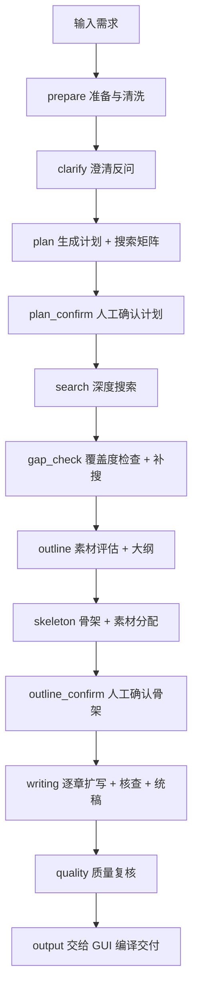
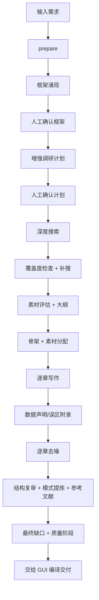

# 小醉桌面研究 Wiki

> 一句话：**代码管流程、预算、证据和交付；AI 只管提问、规划、写作和复核。**

这份文档先讲清楚"一次调研到底怎么跑"，再解释澄清、规划、扩写、补搜、复核分别在什么时候发生、输入输出是什么。

## 目录

1. [流水线总览](#一流水线总览)
2. [逐阶段拆解](#二逐阶段拆解)
3. [数据怎么在阶段之间传](#三数据怎么在阶段之间传)
4. [搜索怎么跑](#四搜索怎么跑)
5. [澄清反问](#五澄清反问)
6. [计划与搜索矩阵](#六计划与搜索矩阵)
7. [扩写与统稿](#七扩写与统稿)
8. [缺口补搜](#八缺口补搜)
9. [复核与质量门禁](#九复核与质量门禁)
10. [失败、恢复与交付](#十失败恢复与交付)
11. [AI 边界与代码地图](#十一ai-边界与代码地图)

---

## 一、流水线总览

### 1.1 一句话

```text
一句话需求
  → 澄清成任务书
  → 计划成搜索批次
  → 搜索成素材池
  → 素材涌现大纲
  → 大纲绑定素材
  → 逐章扩写并复核
  → 全篇统稿
  → 质量自检
  → 编译 Word / Excel / 图表
```

这条流水线不是让 AI 自由发挥，而是把调研拆成固定阶段。AI 在澄清、计划、评估、写作、审稿这些工位上工作；阶段顺序、搜索预算、素材分配、失败恢复和交付格式由代码控制。

### 1.2 两条路径

**常规 / 行业搜索**走标准管线：



**超深度**走框架涌现管线。它不经过常规的 `outline_confirm`：



超深度的框架来自 `load_framework_from_text()`：先抽取行业、实体、维度、核心追问和常见误区，再让用户确认。框架无效时自动回退常规管线。

> 超深度路径在管线内执行最终缺口检查，并在末尾调用统一的 `quality` 阶段（自检、数据防坑、来源多样性、质量评分、确定性门禁）；该阶段失败不阻断交付。带【AI训练知识】标注的章节不计入无来源声明，避免门禁误伤。

### 1.3 常规路径的函数调用顺序

```text
FusionResearchBot.run()
├─ _step_prepare_task()                 清洗输入
├─ _step_v15_deep_mode()                超深度才走；常规返回 False
├─ _step_clarify()                      澄清问题 + 推演 + 用户回答
├─ _step_setup_search_matrix()          批次 × 迭代 × Top K × 预算
├─ _step_generate_plan()                计划书 + 批次解析 + 查询预审
├─ _step_confirm_plan()                确认计划；有修改意见则重新规划
├─ _step_deep_search()                  GPTR + 批次搜索 + 去重 + 深抓
├─ _step_gap_detection()                覆盖度检查 + 补搜
├─ _step_outline_iteration()            素材评估 + 大纲 JSON
├─ _step_skeleton_generation()          骨架草稿 + 章节解析 + 素材分配
├─ _step_outline_interaction()          GUI 确认/修改/回炉/补搜
├─ _step_write_and_polish()             逐章写作 + 核查 + 统稿 + 去噪 + 缺口
├─ _step_quality_check()                自检 + 防坑 + 来源多样性 + 评分
└─ _step_output_to_gui()                行动建议 + 推送 GUI + 保存账本
```

### 1.4 三个固定设计

| 设计 | 做法 | 作用 |
|---|---|---|
| 阶段化 | 每个阶段有名字、输入、输出和失败状态 | 失败可定位、可恢复，不会从头再跑 |
| 预算化 | 批次搜索、计划级补搜、章节补搜、最终缺口补搜从同一个 `search_budget` 扣减；事实核查/审稿内部补搜受查询条数上限约束 | AI 不能自行决定"再搜十轮" |
| 证据化 | 素材池统一、写作带 `[n]`、声明进账本 | 报告里的说法能回到来源 |

---

## 二、逐阶段拆解

阶段名和中文标签定义在 `task_state.py` 的 `STAGE_LABELS`，顺序在 `engine.py` 的 `run()`。

| 阶段 | 输入 | 做什么 | 输出 | 代码入口 |
|---|---|---|---|---|
| `prepare` | 原始需求 | 意图判断、输入安全清洗 | 清洗后的任务 | `_step_prepare_task()` |
| `clarify` | 清洗后的任务 | 生成 3–5 个问题；推演引擎分必问/可推理；GUI 等用户回答 | `refined_task` | `_step_clarify()` / `clarify_questions()` |
| `plan` | `refined_task` | 配置搜索矩阵；生成计划书；解析批次、方向、核心追问；可选查询预审 | `plan_text`、`search_batches`、`plan_directions`、`plan_core_questions` | `_step_setup_search_matrix()` / `_step_generate_plan()` |
| `plan_confirm` | 计划书 | GUI 等待确认；填写修改意见会重新生成计划与搜索批次 | 用户确认信号 / 新计划 | `_step_confirm_plan()` |
| `search` | 计划 + 批次 | GPTR、批次搜索、可选 STORM、去重、深度抓取 | `all_materials`、`memory` | `_step_deep_search()` / `depth_search()` |
| `gap_check` | 素材 + 计划方向 | 对照方向和核心追问算覆盖度；补空缺 | `plan_coverage`、补充素材 | `_step_gap_detection()` |
| `outline` | 素材池 | 生成素材评估和大纲 JSON（章标题、页数、论点、素材编号） | `_material_assessment`、`outline` | `_step_outline_iteration()` / `assess_materials_and_emerge_outline()` |
| `skeleton` | 大纲 | 生成轻量骨架草稿；解析章节；给每章补素材编号 | `zero_draft`、`outline.chapters` | `_step_skeleton_generation()` |
| `outline_confirm` | 大纲 | GUI 确认/修改/回炉/指定补搜 | 最终大纲 | `_step_outline_interaction()` |
| `writing` | 大纲 + 素材 | 逐章写作、事实核查、双向审稿、全篇统稿、去噪、最终缺口、参考文献、声明提取 | `chapters_md`、`claim_ledger` | `_step_write_and_polish()` |
| `quality` | 章节 | 数字/引用/重叠自检、数据防坑、来源多样性、质量评分 | 质量报告、数据受限声明 | `_step_quality_check()` |
| `output` | 章节 + 行动建议 + 素材 | 推送给 GUI；保存声明账本 | GUI 中的报告数据 | `_step_output_to_gui()` |

### 2.1 搜索阶段到底产出了什么

`all_materials` 是一个 `SearchResult` 列表，单条素材包含：

- `title`、`url`、`content`；
- `source`（deepseek / gptr / batch / storm 等）；
- `tier`（S/A/B/C 信源等级）；
- `llm_score`、`reliability`。

它是全流程唯一的素材池。后面的覆盖度、大纲、章节写作、质量检查都从这里取数；`memory` 只是给这个池子建的任务内检索索引，不跨任务持久化，也不是另一份数据。

### 2.2 大纲阶段到底产出了什么

`outline` 的结构是：

```json
{
  "title": "调研报告",
  "chapters": [
    {
      "title": "行业规模与竞争格局",
      "pages": 3,
      "thesis": "本章论点",
      "cases": 1,
      "tables": 2,
      "material_idxs": [4, 5, 6, 7]
    }
  ]
}
```

`material_idxs` 是**从 1 开始**的素材编号，指向 `all_materials`。每章提示要求至少 3 条；超过一半章节为空时会重试；解析不到章节直接失败。

### 2.3 骨架阶段和"零样本草稿"

`skeleton` 不是直接开始写正文，而是先生成一版轻量骨架草稿 `zero_draft`：

1. 用大纲和素材生成每章的骨架段落；
2. 从草稿中解析出章节结构；
3. 对素材不足 3 条的章节，用向量/关键词从素材池补配 `material_idxs`；
4. 保存 `zero_shot_draft.md` 到输出目录的"后台调试"。

后面的逐章写作会用这份草稿里的对应章节作为骨架，而不是让模型重新想结构。

---

## 三、数据怎么在阶段之间传

主要状态都在 `FusionResearchBot` 实例上，关键字段如下：

| 数据 | 产生阶段 | 被谁使用 |
|---|---|---|
| `raw_task` | 入口 | 断点恢复、审计 |
| `refined_task` | 澄清 | 计划、搜索、写作 |
| `plan_text` | 计划 | 人工确认、GPTR enriched query |
| `search_batches` | 计划解析 | 批次搜索 |
| `plan_directions` / `plan_core_questions` | 计划提取 | 覆盖度评估、大纲评估 |
| `all_materials` | 搜索 | 覆盖度、大纲、写作、质量 |
| `plan_coverage` | 覆盖度检查 | 补搜、GUI 控制面 |
| `_material_assessment` | 大纲 | 骨架生成、回炉 |
| `outline` | 大纲 | 骨架、确认、写作 |
| `zero_draft` | 骨架 | 逐章写作的骨架来源 |
| `chapters_md` | 写作 | 质量检查、交付编译 |
| `claim_ledger` | 搜索/写作 | 来源附录、账本文件 |

任务状态由 `TaskStateStore` 落在：

```text
output_dir/任务状态/<task_id>/
├─ task.json               阶段状态、尝试次数、错误、交付物记录
├─ artifacts/
│  ├─ pipeline.json        任务、计划、批次、覆盖度、大纲、章节快照
│  ├─ materials.json       已获取素材
│  ├─ outline.json         报告大纲
│  └─ material_assessment.json
├─ chapters/01.md ...      逐章落盘
├─ zero_shot_draft.md      骨架草稿
└─ report.md               当前报告草稿
```

重试时先恢复这些字段，再跳过已完成的阶段。已经写好的章节直接从 `chapters/` 复用。

---

## 四、搜索怎么跑

`depth_search()` 的顺序是：

1. **GPT Researcher**：用精简 enriched query（任务主体 + 最多 3 个方向标题，上限 150 字）提交研究任务；长 query 会让 GPTR 不拆子查询，召回反而变差。拿回原始报告后按 5000 字分片解析成素材（单次长文本会导致 JSON 截断），过滤文档分享平台，写入当前任务的素材池、检索索引和搜索缓存。软文类素材不再整篇丢弃，而是保留可核验事实并标注 `claim_nature=企业自述`。
2. **批次搜索**：按 `search_batches` 逐批执行。每批包含若干查询，批内按 `max_iterations` 迭代，每条查询取 `max_search_results` 个结果。批次搜索按**批次数**扣预算，不是按查询条数扣。
3. **STORM 辩论**：默认关闭（`enable_storm_debate=false`），可在【配置 → 功能配置】勾选。打开后模拟支持者/质疑者/旁观者三方，生成 6–8 条多角度查询，每条取 2 个结果；查询数会从搜索预算中扣减。
4. **跨源去重**：按 URL 去重。
5. **深度抓取**：高评分素材先做 Playwright 增强；开启 `enable_deep_scrape` 时，再对 Top N 高价值 URL 抓全文。
6. **声明登记**：把搜索素材登记到声明账本，供后续来源附录使用。

> 不做跨任务记忆复用：`memory.py` 只为当前任务的 `all_materials` 建 BM25/向量检索索引，任务结束即丢弃，不读取历史知识库。

搜索层的可靠性策略：

- GPTR 不可用或调用失败时，由 `search.py` 熔断并回退 DeepSeek Search；
- GPTR 内部日志默认压到 ERROR；排查召回问题时设置环境变量 `GPTR_LOG_LEVEL=INFO` 打开诊断日志；
- 健康检查和自动拉起只对本机 GPTR 地址生效；GPTR 服务默认只监听 `127.0.0.1`，如需局域网访问需显式设置 `SERVICE_HOST`；
- GPTR 任务的 `callback_url` 尚未实现，提交时会被拒绝，请使用任务状态轮询；接口接受的查询会完整传入，不再截断到 400 字；
- 搜索结果会写入 `output_dir/.cache` 的搜索缓存（TTL 7 天），相同查询可复用；它只是搜索缓存，不是知识库，不参与大纲或写作；
- 搜索阶段拿不到任何素材时，`_step_deep_search()` 直接抛错，不带着空素材进入写作。

---

## 五、澄清反问

### 5.1 为什么必须先澄清

同一个题目，不同范围会导出完全不同的报告："看下无糖茶市场"可能指行业全景、竞品对标或进入策略；"分析一下某品牌"可能指商业模式、产品结构或渠道舆情。不问，模型就会按最常见的理解直接开写。

### 5.2 用户看到什么

GUI 展示 3–5 个问题，每个包含：

| 字段 | 作用 |
|---|---|
| `question` | 问题本身，简洁、具体、可回答 |
| `explanation` | 为什么问，帮助用户理解调研价值 |
| `impact` | 回答后如何影响报告方向和深度 |

提示词还要求生成 1–3 个"深度追问"，用于区分"信息收集"和"战略建议"的边界。

### 5.3 不是所有问题都值得问

问题生成后还有一层推演引擎（`shared/deduction_engine.py`）：

1. **世界模型**：前提假设影响范围，范围影响数据可得性，数据可得性影响输出质量；
2. **信息增益排序**：判断每个不确定项对结果的影响大小。

对每个候选问题，它模拟 2–3 种典型回答，然后判断：

- 能否通过联网搜索获得？
- 能否通过常识或计算推导？
- 能否用默认假设覆盖？

任一为"是"，标记为**可推理**。只有涉及用户内部信息（预算、资源、偏好、计划）、独特定位（品牌定位、差异化），或不同回答会导向完全不同方向时，才标记为**必问**。必问项按增益排序，最多 5 个。

### 5.4 全部可推理时怎么办

GUI 下展示一页**推断摘要确认**：列出系统自行处理的项和理由，用户可以补充说明或直接确认。补充内容会作为【用户补充信息】追加到任务。headless 模式下全部可推理则直接使用原任务。

可推理项的上下文只在 `generate_plan()` 注入一次，避免在澄清和规划两个阶段重复拼接。

### 5.5 失败与重试

| 情况 | 处理 |
|---|---|
| 首次少于 3 个问题 | 追加"必须至少 3 个"重试一次 |
| 重试结果更多 | 替换原列表 |
| 重试结果更少 | 按问题文本去重后补充 |
| JSON 解析失败 | 按行降级解析 |
| 推演调用失败 | 全部候选问题照问 |
| 澄清阶段失败 | `StageFailed`，任务落盘，可从澄清阶段重试 |

重建必问列表时优先保留原始 `explanation` 和 `impact`，缺失时才用推演理由补位。

### 5.6 为什么没有任务队列

澄清要求用户在当前上下文里回答。排队任务轮到执行时，用户往往已经离开或忘了当时意图，澄清就失去意义。因此只做单任务交互；失败后通过【重试上次任务】从失败阶段继续。

---

## 六、计划与搜索矩阵

### 6.1 计划书里有什么

`generate_plan()` 要求 AI 按固定结构输出：

| 区块 | 内容 |
|---|---|
| 需求理解 | 3–4 句话，确认对任务的理解 |
| 建议调研方向 | 3–5 个方向，每个说明调研价值 |
| 搜索批次规划 | 2–5 个批次，每批 3–5 条具体查询 |
| 核心追问 | 1–2 个贯穿全文的问题 |
| 上下文规划 | 信息需求清单、优先级、预期缺口与措辞约定 |

风险提醒不再作为固定区块：只有用户需求明确涉及风险、合规或下行压力时，才允许在报告的风险章节内出现，且不得单独成章。检索计划与搜索批次只用于执行，不进入报告目录。

提示词禁止输出"第一章几页、第二章几页"的固定结构——章节结构由素材和大纲决定。

### 6.2 批次怎么设计

- **2–3 批（常规）**：宏观层 → 中观层 → 微观层；
- **4 批及以上（广度调研）**：按"实体 × 维度"交叉展开，行业宏观、第一/二/三梯队、交叉对比，每个实体至少两个维度。

广度模式下，如果用户没有自带企业/品牌清单，系统会先做一次轻量预处理：识别实体类型 → 搜索 Top 5 → LLM 抽取最多 30 个候选实体 → 注入 planner 按梯队分组。检测到用户已有编号清单或企业后缀密集时跳过预处理。

### 6.3 计划不是"写完就算"

1. **长度校验**：首次少于 100 字视为失败，最多重试 3 次；
2. **批次解析**：计划书必须输出【批次1-3】。解析不到时用主题词 + 业务词构造"市场规模 / 行业趋势、竞争格局、运营模式"三层查询兜底，避免退化成任务原文碎片；
3. **批次收敛**：按用户设置的 `search_batches` 截断，防止 AI 自行加量；
4. **搜索预审**（可选）：evaluator 判断查询是否过泛或冗余，可自动改写，失败不影响主流程。

计划中的"调研方向"和"核心追问"会被提取出来，成为覆盖度检查和素材评估的对照基线。**计划是合同**：后面补什么、大纲够不够，都对照它判断。

### 6.4 搜索矩阵

```text
搜索次数 = 批次数 × 每批迭代数
单次取数 = max_search_results（Top K）
总预算   = ResearchState.search_budget
```

常规与深度预设：

| 参数 | 常规 | 深度 |
|---|---|---|
| 搜索批次 | 2 | 3 |
| 每批迭代 | 2 | 3 |
| 单次 Top K | 5 | 10 |
| 搜索密度 Top K | 10 | 15 |
| 自动补搜 | 默认关 | 默认开 |

界面模式：

| 模式 | 行为 |
|---|---|
| 常规报告 | 常规策略，标准管线 |
| 超深度 | 强制框架涌现 + 深度管线 |
| 行业搜索 | 常规策略，但至少 3 批并开启自动补搜，不逐企业展开 |

预算由 `ResearchState` 统一持有和扣减。标准路线的初始预算为 20；批次搜索按批次数扣，补搜按查询数扣。预设中的 `max_search_budget` 是策略页保存值，实际扣减以 `ResearchState` 为准。

### 6.5 人工确认

计划生成后 GUI 等待用户确认。直接确认则进入搜索；如果在反馈框填写修改意见并点击“应用修改”，系统会带着这段意见重新生成计划、重新解析搜索批次，然后再进入搜索。退出确认会让当前阶段失败并保留任务状态，而不是继续用旧计划搜索。骨架生成后同样等待确认，支持修改、回炉和指定补搜。

---

## 七、扩写与统稿

### 7.1 先有骨架，再有文字

1. **素材评估**：评估素材数量、类型和分布；
2. **大纲设计**：每章给出 `title`、`pages`、`thesis`、`cases`、`tables`、`material_idxs`；
3. **素材分配**：大纲提示要求每章至少 3 条素材编号；超过一半章节为空时重试；
4. **骨架确认**：用户可确认、修改、回炉或指定补搜。

解析不到章节直接失败，后续扩写拿到的不是"自由发挥的题目"，而是"论点 + 素材 + 结构"。

### 7.2 单章写作的顺序

`write_chapters()` 对每一章执行：

1. 如果任务状态里已有本章，直接复用；
2. 按 `material_idxs` 从素材池取素材；没有编号时，用"标题 + 要点"检索 Top 10；
3. 素材少于 `expand_min_materials`（默认 3）、`enable_expand_gap_fill` 开启（默认开）且还有预算时，做一次定向补搜；预算不足则跳过；
4. 素材达到 10 条时自动聚类，并按"核心素材 + 语义补充 + 摘要"分层注入；
5. 调用 writer 生成章节；
6. 事实核查；必要时补搜并润色；
7. 双向审稿；有 high/medium 问题时重写；
8. 可选编造检测；
9. 更新跨章上下文；
10. 立即落盘本章。

章节按大纲顺序串行写作，保证跨章上下文一致；每章写完立即落盘，失败可重试。

### 7.3 素材分层注入是什么

素材达到 10 条时自动启用：

1. 先过滤 C 级素材，把剩余素材聚成 5–8 个主题簇；
2. 用 LLM 给簇命名，并对每个簇生成一份简报，作为大纲和跨章上下文；
3. 写某一章时，把该章素材分三层注入：
   - **核心素材**：簇内核心来源，保留完整内容（约 2000 字）；
   - **语义补充**：用标题 + 要点再做一次检索，补 Top 3（约 800 字）；
   - **其他素材**：只给 180 字摘要。

这样做是为了在上下文有限时优先保留最相关的证据，避免几十条素材平铺进 prompt 后被截断。Ollama 不可用或聚类失败时，自动退回普通素材列表，不影响写作。

### 7.4 AI 拿到什么

- 章节标题和骨架；
- 分配到的素材列表；
- 前文核心事实和关键结论；
- 全篇主题簇简报（素材达到 10 条时自动生成）；
- 写作铁律和数据密度要求。

AI 在这个范围内决定叙事顺序、段落节奏、表格组织、案例讲法和标题表达。**人味和创意来自这里，边界也来自这里。**

### 7.5 写作硬约束

- 基于素材写，关键数据标注 `[n]`；
- 数据用表格呈现，但**每个小节最多 1 个表格**，避免表格占满页数；
- 案例具备四要素，严禁套话和元叙述；
- 素材达到 3 条以上时，至少 5 个具体数字、2 个品牌名、1 个案例；
- 标注 `[企业自述]` 的素材只能描述"友商在做什么"，不得用于论证市场规模、增速或趋势；引用其数字必须注明"企业自述"；
- 章节字数超过目标 1.15 倍时自动精简一次，保留数据、引用与案例要素，只删重复论述；
- 骨架不得包含「附：」开头或检索计划、搜索批次、使用说明类章节；用户未提风险时不得新增风险章节。

代码会清理常见的 AI 前缀、内部标记（`[待填充]`、`[素材]`）和转义符号。

### 7.6 三层复核

**事实核查**：受 `enable_self_check_writing` 控制，关闭时跳过此步。开启后检查未解决的 `[CITATION_NEEDED]`、前后矛盾、缺失数据、AI 套话和引用规范；需要时最多补搜 3 条查询，润色原则是"只补充、不改结构、不删已验证内容"。

**双向审稿**：正向按原顺序审，反向把段落顺序颠倒后审，取两份意见的交集；high 级别问题即使单方发现也保留；只对 high/medium 问题触发重写，重写前用问题描述再补一轮素材。这样降低 LLM 审稿的位置偏见。

**全篇统稿**：EditorAgent 保留所有数据、引用编号、表格和事实陈述，删除元叙述和无信息过渡句，统一术语和数字格式。超过 5000 字时分片统稿；章节数不匹配时自动改为逐章统稿，保证章节不丢。

### 7.7 去噪与重写

- **TTD-DR 逐章去噪**：识别无数据支撑的论断、缺案例的泛泛而谈、缺来源的数据，最多补搜 3 条后只补充不重写。
- **低密度重写**：开启 `density_retry_enabled` 时，对每千字数字少于 3 个的章节补搜并重写；默认关闭。
- **认知循环检测**：在低密度重写前，对最近几轮章节做 embedding 相似度检测，超过阈值（默认 0.85）说明在重复无效改写，最多重试 2 次后保留原章节。

### 7.8 成稿后还会做什么

章节写完后，`_step_write_and_polish()` 继续：

1. 逐章去噪；
2. 用定稿章节做最终缺口检查；
3. 结构复审；
4. 模式提炼；
5. 生成参考文献；
6. 从报告提取声明到 `ClaimLedger`；
7. 保存 `report.md` 和章节文件。

---

## 八、缺口补搜

### 8.1 为什么分三层

一次搜索不可能覆盖所有问题。缺口会在不同阶段暴露：搜完发现某方向没素材、写到某章素材不够、核查发现数据没来源、全文写完发现关键子话题没覆盖。只在最后补，已写章节不会吸收新素材；每写一句都搜，成本失控。因此分三层。

### 8.2 第一层：计划级

搜索完成后，`check_plan_coverage()` 对照计划方向和核心追问检查覆盖度：

1. 从方向文本提取 3–5 个中文关键词，过滤停用词；
2. 统计关键词在素材中的命中次数；
3. 方向：`>= 5` 为充足，`1–4` 为一般，`0` 为空缺；
4. 核心追问只区分"有命中"和"空缺"，不套用 5 条阈值；
5. 完全没命中时回退向量检索，相似度 `> 0.3` 计入覆盖。

补搜规则：

- 只补"空缺"且有查询的方向；
- 空缺 `>= 3` 时走搜索密度深挖，最多扣 3 预算；
- 否则最多补 5 条查询，每条取 3 个结果，按查询数扣预算；
- 补搜后立即重新匹配章节素材；
- `auto_supplement=false` 时整层跳过。

### 8.3 第二层：章节级

| 触发 | 条件 | 上限 |
|---|---|---|
| 素材不足 | 本章素材少于 `expand_min_materials`（默认 3，默认开启补搜） | 1 条组合查询，取 5 个结果，扣 1 预算 |
| 事实核查 | `need_search=true` | 最多 3 条查询，每条取 2 个结果 |
| 去噪 | 无数据支撑或缺来源 | 最多 3 条查询，扣对应预算 |

原则是**只补本章**：查询由章节标题、要点或具体问题生成，补到的素材优先用于当前章节。

### 8.4 第三层：最终缺口

章节定稿后，`final_gap_check()` 让模型审视定稿正文，列出最多 3 个"最应该补充但未覆盖"的子话题：

- `auto_fill_final_gaps`：默认开；
- `auto_fill_max_gaps`：默认 3；
- `auto_fill_rounds`：默认 1；
- `auto_fill_sources_per_round`：默认 20，平均分给各缺口；
- 后续轮次追加"数据 案例""趋势 对比""政策 风险"等修饰词；
- 每条查询扣 1 预算。

最终缺口补搜发生在章节定稿之后，新增素材进入素材库并记录缺口，但**不会自动回头重写已定稿章节**。它用于收尾补证和给人工复核提供线索。

### 8.5 什么时候停

1. 预算耗尽；
2. 对应开关关闭；
3. 没有可执行的缺口查询；
4. 补搜没有结果，记录日志后继续。

不存在"AI 觉得还不够就继续搜"的路径。

### 8.6 去重与缓存

- 同一查询在 `SearchManager` 内按规范化文本去重；
- 跨来源（GPTR、批次搜索、STORM）按 URL 去重；
- 同一品牌的软文按域名合并为一个信源，正文去重后拼接并记录 `merged_count`，避免 5 篇软文被当成 5 个独立证据；
- 素材准入按主题词匹配；长主题词允许命中其 3 字连续子串（如"儿童专注力"命中"专注力"），防止有效素材被误杀；
- 搜索结果会写入 `output_dir/.cache` 的搜索缓存（TTL 7 天），相同/归一化查询可复用；
- 搜索缓存只用于减少重复请求，不参与大纲和写作，也不是跨任务知识库；
- 文档分享平台在 GPTR 结果中被过滤，避免只拿到页面元信息。

---

## 九、复核与质量门禁

### 9.1 报告自检

`_post_generation_self_check()` 用纯规则扫描全文：

| 指标 | 阈值 | 不达标意味着 |
|---|---|---|
| 数字密度 | 每千字 `>= 3` 个数字 | 论述偏空，缺数据支撑 |
| 引用密度 | 每章 `>= 2` 个 `[n]` | 素材匹配不足或漏标来源 |
| 引用编号 | `[n]` 必须落在 `1..min(素材数, reference_list_limit)` | 正文引用了不存在的来源 |
| 章节重叠度 | 相邻章节前 2000 字相似度 `< 30%` | 内容重复，需合并或删减 |

开启 `density_retry_enabled` 时，会对最多 3 个低密度章节补搜并重写；默认关闭。

### 9.2 数据防坑

`_data_trap_check()` 结合正则和 LLM 检查四类问题：

| 类型 | 例子 |
|---|---|
| 单位搞混 | "亿"和"万"直接比较，"美元"和"元"混用 |
| 趋势造假 | 连续多年数据完美平滑增长 |
| 张冠李戴 | 出货量当零售量、GMV 当营收、注册用户当月活 |
| 跨章矛盾 | 同一指标在不同章节数值不同 |

规则层负责单位、口径词和增速异常；LLM 层负责语义层面的张冠李戴和跨章矛盾。LLM 检查失败只记录警告。

### 9.3 来源多样性

`_check_source_diversity()` 统计独立来源和域名：

- 来源 `< 8` → 数据受限；
- 独立域名 `<= 3` → 数据受限；
- 单一域名占比 `> 50%` → 数据受限。

判定受限时不会静默通过，而是与其他覆盖信号合并成报告开头的一段「素材覆盖说明」：来源多样性受限、批次搜索因预算不足被跳过、章节由 AI 训练知识补写，三者各占一行。这一步不阻止输出，但把局限写在明面上。

### 9.4 质量评分

`_quality_scorer()` 默认 `basic` 模式，纯统计：

| 维度 | 计算 |
|---|---|
| 数据密度 | 数字数 / 千字，是否达到 `quality_min_data_density`（默认 3） |
| 来源覆盖 | 不同 `[n]` 数量，是否达到 `quality_min_source_coverage`（默认 3） |
| 引用密度 | 引用次数 / 段落数（记录，不计入综合分） |
| 章节均衡 | 各章长度与平均长度的偏差 |
| 引用支持率 | `supported` 声明 / 全部声明，是否达到 `quality_min_support_ratio`（默认 0.6） |
| 综合分 | 数据密度达标分、来源覆盖达标分、章节均衡、引用支持率（以及 full 模式下的逻辑分）的平均值 |

`full` 模式额外调用 LLM 评估逻辑连贯性，并计算搜索策略质量（搜前规划、搜中执行、搜后利用）。

评分是工程自检，不是事实仲裁。它能发现"数据太少、来源太集中、章节畸长畸短"，但不能证明每个数字都正确。

### 9.5 声明账本与门禁

`ClaimLedger` 记录每条声明的类型、值、来源、来源日期、写入节点和状态：`supported` / `unsupported` / `inferred` / `disputed` / `override`。

声明判定分三步：

1. 句子里有没有有效 `[n]`：没有编号或编号越界 → `unsupported`；
2. 有 `[n]` 时，声明里的数值是否能在对应素材原文找到：先去千分位和全角差异，亿/万/千按量级换算，普通数值允许 2% 相对误差，百分比放宽到 5% 或 0.5 个百分点；命中 → `supported`；
3. 编号有效但数值找不到 → `inferred` 并标记 `number_miss`，含义是"引了来源，但原文没有这个数"。

不含数值的定性结论只校验编号。因此 `QualityGate.run_gate()` 的 summary 分三档：无来源 / 数值未命中 / 被质疑。

质量阶段现在会实际调用 `QualityGate.run_gate()`：结果写入事件日志和任务状态；未通过时在报告开头插入“质量门禁未通过”说明，分别列出无来源声明、数值未命中的声明和被质疑声明。门禁不阻断交付，`quality` 仍是 `critical=False`，但不再静默通过。常规路径和超深度路径都在报告收尾时走同一套质量阶段；带【AI训练知识】标注的章节没有外部来源，提取声明时会跳过，不计入无来源声明。

来源追溯表和参考文献默认各列 50 条，可通过 `source_appendix_limit` / `reference_list_limit` 调整；设为 `0` 表示全部。参考文献编号保持与正文一致，重复 URL 会显示为“同 [n]”。

### 9.6 为什么质量阶段不阻断

质量检查失败就丢弃整篇报告，用户会失去已完成的素材和章节。更合理的做法是：把问题写进日志和产物、标注数据受限、保留报告让用户决定是否补搜或重写。因此 `quality` 阶段用 `critical=False`；核心阶段（澄清、计划、搜索、写作）仍然失败即停。

### 9.7 怎么读这些结果

| 看到什么 | 说明 |
|---|---|
| 数字密度低 | 报告偏定性，建议补搜数据密集型方向 |
| 引用密度低 | 素材匹配不足或写作漏标来源 |
| 章节重叠高 | 大纲有重复主题，建议合并 |
| 来源多样性受限 | 公开信息有限或搜索过于集中 |
| 数据陷阱告警 | 人工核对单位、口径和跨章数值 |
| 质量门禁未通过 | 看报告开头的无来源、数值未命中或被质疑声明，补搜或删除对应结论 |
| 数值未命中 | 正文引用了 `[n]`，但素材原文找不到这个数值；优先核对素材原文，再决定改数或换引用 |
| 素材覆盖说明 | 批次被预算跳过、章节由 AI 补写或来源过于集中；结论需谨慎使用 |
| 引用编号越界 | 正文引用了不存在的素材编号，检查写作输出或参考文献上限 |
| 质量分不高 | 先看具体维度，不要只看综合分 |

---

## 十、失败、恢复与交付

### 10.1 阶段失败

每个阶段通过 `_run_stage(name, fn, critical=True)` 执行：

1. 已完成的阶段跳过；
2. 超时、连接失败、限流等瞬时错误最多自动重试 2 次（退避 5 秒、15 秒）；
3. 非瞬时错误立即失败，不浪费重试；
4. 核心阶段最终失败写入 `StageFailed`，任务状态落盘；
5. 非核心阶段失败只记录 `optional_failed`；
6. 重试时从失败阶段继续，已写章节直接复用。

任务状态目录见[第三节](#三数据怎么在阶段之间传)。GUI 的【重试上次任务】会带上 `resume_task_id`，引擎恢复快照后跳过已完成阶段。

### 10.2 交付不是引擎直接写 Word

`output` 阶段做三件事：

1. 生成行动建议；
2. 把 `chapters_md`、行动建议、素材列表推给 GUI；
3. 保存声明账本。

真正的编译在 `main.py` 的 `run_bot()` 里，`bot.run()` 返回后：

1. 生成图表；
2. 生成 Excel 附录；
3. 生成 Dashboard；
4. 编译 Word 主报告（附来源附录）；
5. 生成精炼版 Word；
6. 生成同名 Excel 附录；
7. 生成 S/A/B/C 溯源 Excel；
8. 把报告路径写回任务状态和 GUI。

图表生成直接读取报告里的数值表：识别「突破80亿元」「1.2万家」「60余家」等复合数值，跳过来源/编号列，时间区间按跨度计算；同一张图只放同量纲数据。表格数据不足时才降级到 Mermaid / Matplotlib。

图表、附录、Dashboard、精炼版、溯源失败会记录后继续；Word 主报告编译失败会让任务进入失败分支。

### 10.3 产物

| 产物 | 说明 |
|---|---|
| `调研报告_*.docx` | 主报告，含来源附录 |
| `调研报告_*_数据来源.xlsx` | 素材来源、数据点、信源等级 |
| `data_appendix.xlsx` | 数据附录 |
| 图表 PNG | 根据报告数值表生成，插入 Word 正文与 Dashboard |
| Dashboard | 调研概览页 |
| 精炼版 Word | 常规版/深度版精简报告 |
| `任务状态/<task_id>/` | 阶段状态、素材、大纲、章节、报告 |

---

## 十一、AI 边界与代码地图

### 11.1 分层

| 层 | 组成 | 是否用 AI | 职责 |
|---|---|---|---|
| 交互层 | tkinter GUI、sv-ttk、控制面指令解析 | 否 | 输入、展示澄清/计划/骨架、日志、产物、重试；支持改页数、加图表、删章节、调顺序、补素材 |
| 控制层 | `engine.py`、`task_state.py`、`ResearchState` | 否 | 阶段顺序、预算、状态落盘、重试、断点恢复 |
| 规划层 | `generate_plan()`、`_parse_search_batches()`、`framework_loader.py` | 是（受结构化约束） | 方向、追问、搜索批次、自定义框架 |
| 检索层 | `search.py`、`memory.py`、`deep_scraper.py`、`shared/search/` | 部分（打分） | 多源搜索、抓取、去重、分级、缓存、混合检索 |
| 素材层 | `material_synthesizer.py`、`knowledge_extractor.py` | 部分（聚类命名） | 主题聚类、分层注入、实体与数据点抽取 |
| 写作层 | 章节扩写、事实核查、双向审稿、统稿 | 是 | 在素材与骨架约束内写作与复核 |
| 证据层 | `shared/claim_ledger.py`、`QualityGate`、来源编号 | 部分 LLM 抽取 + 规则校验 | 声明与来源绑定、质量检查、过程留痕 |
| 交付层 | `deliverables.py`、`shared/md_to_docx.py` | 部分（表格数据直读 + 图表代码生成） | Word/Excel/图表/Dashboard/精炼版 |
| 安全层 | `shared/agent_security.py`、`input_guard.py`、`prompt_security.py`、`robots_checker.py`、`config.py` 密钥加密 | 否 | 输入清洗、注入防护、工具调用审计、robots 合规、密钥加密 |
| 恢复层 | `task_state.py` | 否 | 阶段状态、原子写、断点恢复 |

### 11.2 AI 的权限边界

AI 可以：

- 判断哪些澄清问题必须问、哪些可以自行推理；
- 提出调研方向、核心追问、搜索批次；
- 在给定素材和骨架下扩写章节；
- 审稿、事实核查、批评和改写；
- 对全篇统稿、去噪、提炼模式。

AI 不可以：

- 自行增加搜索预算或跳过阶段；
- 在没有素材支撑时编造数据、品牌、案例；
- 改变章节数量、标题和交付结构；
- 在质量检查失败时静默通过；
- 把未完成的阶段当成成功。

这些边界中，能确定性检查的部分由代码约束：搜索前 `state.consume_budget()` 原子扣减；章节写作只接收分配好的素材；大纲解析失败直接抛异常；来源编号和附录由代码汇总；质量阈值写死在检查函数里。但代码不能保证模型完全不编造，质量检查只能降低风险，关键数据仍需人工复核。

### 11.3 预算与证据

**预算**：`ResearchState` 持有 `search_budget`。批次搜索、计划级补搜、章节定向补搜、最终缺口补搜和去噪补搜都通过 `consume_budget()` 扣减；事实核查和审稿内部的补搜受查询条数上限约束。预算耗尽后停止补搜并记录日志。

**证据**：写作要求 `[n]` 来源编号；`ClaimLedger` 记录声明、来源、来源日期、写入者和状态；`QualityGate` 用确定性代码检查无来源、过期和被质疑声明；报告附来源附录和声明账本调试文件。

### 11.4 已知结构债务

- `engine.py` 仍是单体大文件，阶段逻辑和业务逻辑混在一起；
- `search.py` 同时承担搜索、抓取和 GPTR 服务生命周期管理；
- 超深度模式在 `run()` 中提前返回，虽然末尾已接入统一 `quality` 阶段，但不经过常规的 `outline_confirm` 等交互阶段，章节结构约束弱于常规路径。
- 页数是写作预算而非排版结果：正文按约 600 字/页、精炼版按约 800 字/页估算，项目未做 Word 渲染后的页数回测。
- 成本统计读取配置里的估算常数（如 `gptr_cost_per_session`），用于量级参考，不是真实账单。

### 11.5 代码地图

| 想改什么 | 先看哪里 |
|---|---|
| 阶段顺序、阶段重试、流水线 | `调研工具/engine.py` 的 `run()` / `_run_stage()` |
| 澄清与推演 | `clarify_questions()`、`shared/deduction_engine.py` |
| 计划与搜索批次 | `generate_plan()`、`_parse_search_batches()` |
| 搜索与抓取 | `调研工具/search.py` |
| 素材聚类与分层注入 | `调研工具/material_synthesizer.py` |
| 章节扩写与统稿 | `write_chapters()`、`_editorial_review()` |
| 覆盖度与补搜 | `check_plan_coverage()`、`final_gap_check()` |
| 报告复核 | `_post_generation_self_check()`、`_data_trap_check()`、`_quality_scorer()` |
| 交付物 | `调研工具/deliverables.py`、`main.py` 的 `run_bot()` |
| 任务状态与恢复 | `调研工具/task_state.py` |
| 声明账本与质量门禁 | `shared/claim_ledger.py` |
| 无 GUI 运行与评测 | `cli.py`、`eval/README.md`、`eval/questions.json` |
| 依赖与命令入口 | `pyproject.toml` |

### 11.6 模块清单

自研代码约 2.1 万行：调研工具 15.5k、shared 4k、gptr_service 1.4k；另带补丁 GPT Researcher 约 11k 行。

**调研工具（24 个文件）**

| 文件 | 职责 | 状态 |
|---|---|---|
| `main.py` | tkinter GUI、日志代理、控制面交互、产物编译入口 | 主链路 |
| `engine.py` | 阶段机、预算、断点、写作与复核、质量门禁 | 主链路 |
| `search.py` | 多适配器搜索、打分、Playwright 增强、GPTR 适配、STORM | 主链路 |
| `memory.py` | Ollama 向量 + BM25 混合检索 | 主链路（可降级） |
| `material_synthesizer.py` | 素材聚类、簇命名、综合报告 | 主链路 |
| `knowledge_extractor.py` | 实体、数据点、知识抽取 | GUI 辅助 |
| `deliverables.py` | Word/Excel/图表/Dashboard/精炼版 | 主链路 |
| `deep_scraper.py` | DeepSeek Fetch / Crawl4AI 深抓、robots 检查 | 主链路（可选） |
| `task_state.py` | 阶段状态、原子写、失败恢复 | 主链路 |
| `framework_loader.py` | 自定义研究框架模板 | 主链路（可选） |
| `v15_3_config.py` | 信源 S/A/B/C 分级与章节预算 | 主链路 |
| `v16_1_utils.py` | 成本追踪、全文增强、智能截断 | 主链路 |
| `config.py` | LLM 客户端、提示词、密钥加密、页面配置 | 主链路 |

**shared（19 个文件）**

| 文件 | 职责 |
|---|---|
| `claim_ledger.py` | 声明账本、声明状态、QualityGate |
| `deduction_engine.py` | 推演引擎：判断必问 / 可推理 |
| `input_guard.py` | 输入清洗、注入检测、截断 |
| `agent_security.py` | 工具调用策略与审计 |
| `browser_manager.py` | 浏览器生命周期与失败切换 |
| `robots_checker.py` | robots.txt 合规检查 |
| `md_to_docx.py` | pandoc / python-docx 双路径转换 |
| `prompt_cache.py` | 提示词缓存与复用 |
| `prompt_security.py` | 系统提示安全后缀 |
| `search/` | 适配器、信源分级、缓存、打分 |
| `llm_client.py` | JSON 清洗与安全解析 |

**gptr_service（9 个文件）**

| 文件 | 职责 |
|---|---|
| `main.py` | FastAPI 入口、健康检查、配置加载 |
| `api/routes.py` | 提交 / 查询 / 取消任务、批量提交、配置重载 |
| `core/queue.py` | 任务队列、优先级、状态机、超时 |
| `core/worker.py` | 执行 GPTR 研究、任务级配置注入、日志抑制 |
| `core/keepalive.py` | 空闲回收与健康保活 |
| `core/embedding_check.py` | embedding 输入长度实测 |
| `client.py` | HTTP 客户端、轮询、清理 |

---

[返回 README](../README.md)
